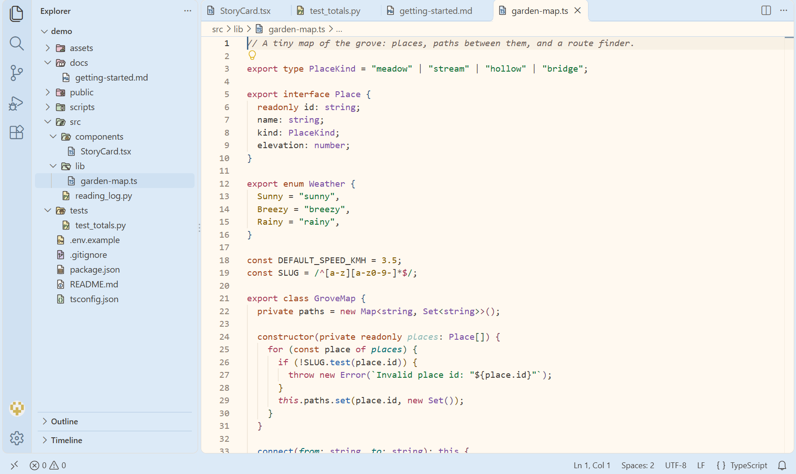
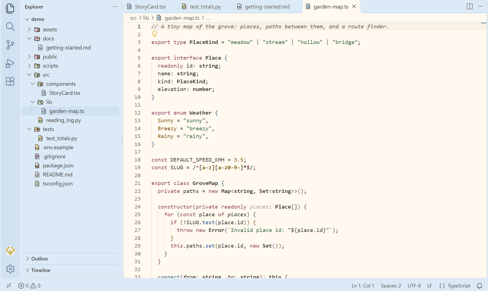
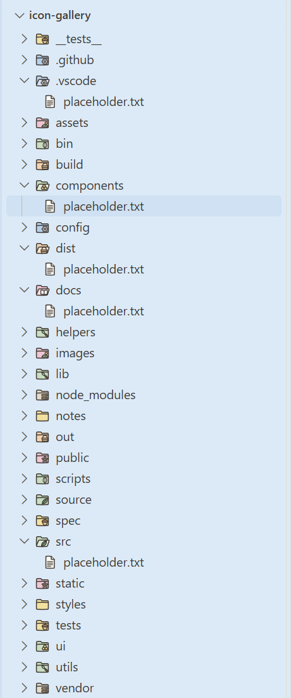
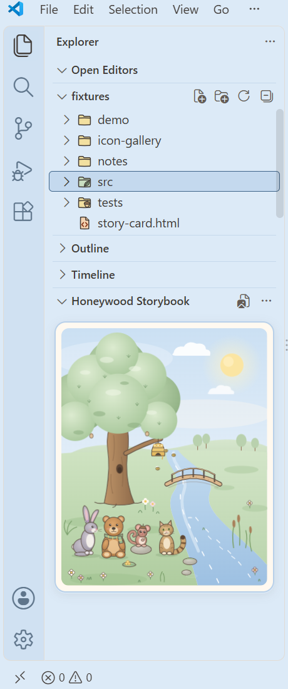
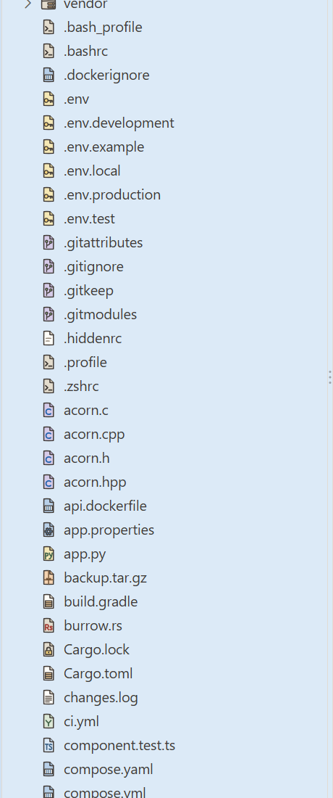

# Honeywood: A Pastel Woodland Theme

A calm, pastel **light** theme for Visual Studio Code, with cream "paper" editors, powder-blue chrome and a set of hand-drawn woodland file icons. It's inspired by the warm, gentle atmosphere of classic storybook illustration, while keeping code clear and easy to read.

## What's included

| Contribution | Name | What it is |
|---|---|---|
| Colour theme | **Honeywood — Picture Book** | The livelier style: a distinct colour for each kind of code, such as keywords, declarations, strings, functions, numbers, types, parameters and decorators. |
| Colour theme | **Honeywood — Quiet Ink** | The calmer style: four dusty accent colours, with structure shown through **bold** types and *italic* parameters and comments. |
| File icon theme | **Honeywood Icons** | 58 original icons: 12 woodland-motif folder types (closed and open), 31 file types, and default file and folder icons. |
| Explorer view (optional) | **Honeywood Storybook** | A small, collapsible illustration panel in the Explorer. It shows a gently animated, original Honeywood woodland scene, or a picture of your own. |

Both colour themes share the same interface (cream editor; powder-blue sidebar, tabs and status bar) and differ only in syntax colouring.

## Design philosophy

- **Warm and gentle, never harsh.** The interface uses a soft palette (cream `#FFF9F0`, powder blue `#DCEAF7`, sage, blush, butter yellow), with warm ink `#403A36` for text instead of black.
- **Readable first.** Every syntax colour meets a WCAG contrast ratio of at least **4.5 : 1**. That holds on the editor background, the current-line highlight, focused and unfocused selections, and the peek editor, and it's checked automatically.
- **Clear at 16 pixels.** Icons are drawn on a 32×32 grid with consistent soft ink outlines, and each one was reviewed at true 16 px. Folders are tinted by category so they're easy to scan, for example sage for source, blush for content, powder blue for configuration and apricot for build output.
- **Woodland motifs** on special folders: a leaf (`src`), an acorn (`tests`), an open storybook (`docs`), a hill and sun (`assets`), a daisy (`public`), honeycomb cells (`components`), a garden trowel (`lib`), an upright feather (`scripts`), a woven basket (`dist`), stacked logs (`node_modules`) and a branching twig (`.git`).

## Installation

**From a `.vsix` file:**

1. In VS Code, open the Extensions view (`Ctrl+Shift+X`).
2. Open the `…` menu and choose **Install from VSIX…**.
3. Select `honeywood-theme-1.2.0.vsix`.

## Setup

1. **Choose a colour style.** After installing, VS Code opens the colour theme picker. Choose **Honeywood — Picture Book** or **Honeywood — Quiet Ink**. To change it later, use **File → Preferences → Theme → Color Theme** (`Ctrl+K Ctrl+T`).
2. **Turn on the icons.** Honeywood then asks once whether you'd like the matching file icons:
   - **Use Honeywood Icons** switches your file icon theme to Honeywood Icons.
   - **Not now** asks again in a week, or the next time you choose a Honeywood colour theme after that.
   - **Don't ask again** stops the question for good.

   If the message disappears before you answer, it's waiting under the bell icon in the bottom-right corner of VS Code.

Honeywood never changes your file icon theme unless you click **Use Honeywood Icons** or run one of the commands below. Switching between Picture Book and Quiet Ink doesn't bring the question back.

**Commands** (open the Command Palette with `Ctrl+Shift+P` and type "Honeywood"):

- **Honeywood: Set Up Colours and Icons** lets you choose a colour style, and turns on Honeywood Icons too.
- **Honeywood: Use Honeywood Icons** turns on the icons.

You can also choose the icons yourself: **File → Preferences → Theme → File Icon Theme**, then **Honeywood Icons**. The colour themes and the icon theme are independent, so you can use either one on its own.

## Honeywood Storybook (optional sidebar illustration)

**Honeywood Storybook** is a small picture panel at the bottom of the Explorer, below your files. It starts collapsed, so it only takes up one header line until you open it.

- **Open or close it:** click its **Honeywood Storybook** header, or run **Honeywood: Show Storybook**. Drag the line above it to make it taller or shorter.
- **Hide it completely:** right-click any Explorer section header and untick **Honeywood Storybook**. To bring it back, tick it again, or use the Explorer's `…` menu.
- **Default picture:** an original, gently animated Honeywood woodland scene. Four friends sit together beside a winding river under a big oak:
  - **Bramble**, a toasted-caramel bear cub in a sage scarf;
  - **Willow**, a grey hare with a heather sprig;
  - **Pip**, a tiny rosy-brown dormouse in an acorn-cup hat;
  - **Tansy**, a tawny wildcat kitten with a ringed tail.

  There's a beehive with honeycomb, a little wooden bridge, mossy stones and daisies.
- **What moves, slowly and quietly:**
  - Bees drift around the hive, and one visits the flowers.
  - The river flows and sparkles.
  - Leaves, reeds and daisies sway.
  - The friends breathe, blink and now and then tilt their heads or flick a tail or ear.
  - A butterfly and a bird pass by from time to time.
- **Pause the animation:** use the view's `…` menu or run **Honeywood: Pause Storybook Animation**. Run **Honeywood: Resume Storybook Animation** to start it again. The scene is also still whenever your operating system asks apps for reduced motion, or VS Code's **Reduce Motion** setting (`workbench.reduceMotion`) is on.

**Using your own picture**

1. Run **Honeywood: Choose Sidebar Illustration**, or click the picture icon in the view's title bar or **Choose illustration…** on the picture.
2. Pick a PNG, JPEG, WebP, GIF, AVIF or BMP file (up to 50 MB). It appears straight away.
3. Optional settings (search for "Honeywood Storybook" in Settings):
   - **Caption** (`honeywood.storybook.caption`): a short line under the picture.
   - **Fit** (`honeywood.storybook.fit`): **whole** shows the entire picture; **fill** fills the panel and trims the edges, which suits wide pictures in a tall sidebar.
   - **Focus** (`honeywood.storybook.focus`): with **fill**, which part stays in view.

To change it, hover over the picture and click **Change…**. To go back to the woodland scene and its animation, run **Honeywood: Use Default Illustration** or use the view's `…` menu. Click the picture to open it full size. Honeywood doesn't animate your own pictures; an animated GIF plays as it normally would.

If the file is moved, renamed, deleted, unreadable or isn't a valid image, the panel shows the woodland scene with a short note explaining why. iPhone HEIC photos need saving as JPEG or PNG first.

**Your picture stays private**

- Honeywood only stores the file's path, in your user settings as `honeywood.storybook.imagePath`. The file itself is never copied, uploaded, sent over the network, or added to your project.
- The panel loads nothing from the internet. Its security policy only allows Honeywood's own script and style, plus images from VS Code's local resource scheme. The built-in scene is part of the page, so it reads no files at all. A chosen picture can only be read from the folder it's in.
- Honeywood has no analytics or telemetry.
- Only use pictures you have permission to use. You're responsible for the artwork you choose.

**Limitations**

- **Panel height:** VS Code shares the Explorer's height between its open sections. When you open Open Editors, the file tree or Outline, the Storybook panel gets shorter. The picture then shrinks to fit the space it has, without scrolling or distortion. Drag the line above the panel, or collapse other sections, to give it more room.
- **Settings Sync:** the path is a machine-specific setting, so it isn't synced. Choose the picture again on each computer.
- **Multi-root workspaces:** the picture is a user setting, so every window and workspace shows the same one.
- **Remote development (SSH, WSL, containers):** Honeywood runs on your local machine where possible, so choose a picture stored on your own computer. If VS Code runs Honeywood on the remote side, choose a file on that machine instead.
- **VS Code for the Web** (vscode.dev, github.dev): the panel isn't available there. The themes and icons still work.
- **Scope of access:** VS Code can only allow access to whole folders. Keeping your picture in a folder of its own, such as `Pictures\Honeywood\`, keeps that access as narrow as possible.

## Icon coverage

| Group | Covered |
|---|---|
| Code | Python, TypeScript (incl. `.tsx`), JavaScript (incl. `.jsx`), HTML, CSS, SCSS/Sass, C#, Java, Go, Rust, C/C++, shell scripts, PowerShell |
| Data & config | JSON, YAML, XML, TOML/INI/CFG/CONF/properties, SQL, `.env` files |
| Documents | Markdown, plain text and logs, PDF, README, LICENSE |
| Media | Images (incl. SVG), fonts, archives |
| Tooling | `.gitignore` and other `.git*` files, lock files, package manifests (e.g. `package.json`, `pyproject.toml`, `Cargo.toml`, `go.mod`), Dockerfile and Compose files |
| Folders | `src`, `tests`, `docs`, `assets`, `config` (incl. `.vscode`, `.github`), `public`, `components`, `lib`/`utils`, `scripts`/`bin`, `dist`/`build`/`out`, `node_modules`/`vendor`, `.git` |

Exact file names take priority over extensions, so `package.json` shows the package icon rather than the JSON icon. Files and folders that aren't recognised use neutral default icons. The full list of names, extensions and language IDs is in `docs/ICON-MAPPINGS.md` in the source repository.

## Limitations and known issues

- **Light theme only.** There's no dark variant in this release.
- **Some file types aren't covered yet.** For example Makefile, CSV, Ruby, PHP, Kotlin, Swift, Vue, Svelte and notebooks show the default icons.
- **TSX and JSX reuse the TS and JS icons.** A separate marker wasn't legible at 16 px.
- **Two minor contrast cases** were reviewed and accepted:
  - On the yellow *current search match* highlight, function names measure about 4.2 : 1.
  - In Picture Book, the colour for invalid code is close to the declaration colour. Invalid code is always underlined, and VS Code adds an error squiggle.
- **Some icons are small at 16 px**, such as the `.gitignore` twig and the "Rs" on Rust files. They're clearer at larger sizes or with display scaling.

## Originality

All colours, theme definitions, icon artwork and the Storybook woodland illustration in Honeywood were created for this project. The icons are original drawings of generic objects, letters and woodland motifs. The Storybook scene and its four woodland friends were designed for Honeywood. They're drawn from simple shapes in the Honeywood palette, and aren't based on characters from any book, film or other product. No artwork, illustrations, characters or logos from other products or publishers are included, and no third-party assets are bundled. Honeywood is not affiliated with or endorsed by any company, publisher or open-source project mentioned here. Language and tool names are used only to describe which files an icon applies to.

## Licence

Honeywood is licensed in two parts:

- **Code: MIT License.** The colour theme definitions and colour palette, the icon mapping file, the small setup code that offers the icons and runs the Storybook view, the build, test and preview scripts, the test fixtures and the documentation text. You may reuse, modify and redistribute this code under the terms in `LICENSE`.
- **Artwork: all rights reserved, with some permissions.** The original icon artwork, the Storybook woodland illustration, the Marketplace icon, the screenshots and the drawing scripts that generate the icons. `ARTWORK-LICENSE.md` lists the exact folders.
  - **Allowed:** using the extension for any purpose (including commercial), sharing the unmodified official package, showing it in screenshots and reviews, and building and testing it locally from source.
  - **On GitHub:** viewing and forking the repository is allowed, as GitHub's Terms of Service provide.
  - **Needs permission:** distributing your own build or a modified package that contains the artwork (even a rebuild of unchanged source), or reusing the artwork in other projects. To publish your own theme based on this code, replace the artwork with your own.

Copyright © 2026 Honeywood.

## Changelog

See `CHANGELOG.md`.

## How Honeywood was built

Honeywood is built from a small set of sources rather than hand-edited JSON:

- **One palette, two styles.** Every colour lives in a single palette file. The syntax colours were derived in the OKLCH colour space, keeping each hue and making it as vivid as possible while still reaching 4.5 : 1 contrast on every editor surface.
- **Automated checks.** A validator runs about 1,700 checks before every build: contrast, colour distinctness, SVG safety and icon-mapping integrity. A separate test suite resolves about 125 real-world file and folder names the way VS Code does, and checks the icon chosen for each.
- **Icons reviewed at true size.** The icons were designed in small batches and judged at a true 16 px on preview sheets and in realistic file trees, then checked in a real VS Code window.
- **Clean packaging.** The extension package is built from an allowlist, so only the themes, icons, manifest and docs are shipped.

See `docs/DEVELOPMENT.md` for the project layout and commands.
